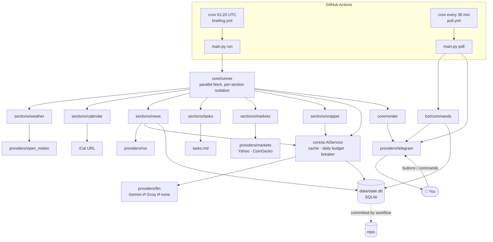

# ☀️ Briefing Bot

**A free, modular morning briefing delivered to your Telegram at 7:00 AM IST — weather, calendar, Real Madrid scores and news, ranked headlines, tasks, markets and a daily tip — running entirely on GitHub Actions and free-tier APIs, so it costs ₹0 and needs no laptop or server.**

- **₹0 by design:** Open-Meteo, RSS, Yahoo/CoinGecko, Gemini free tier, Telegram Bot API, GitHub Actions free minutes.
- **Never fails to send:** every section fails on its own, the LLM is optional, and there is a non-AI fallback for everything.
- **Learns your taste:** 👍 / 👎 / 🔖 under each story re-ranks tomorrow's news toward what you like.
- **One config file:** everything personal lives in [`config.yaml`](config.yaml). Secrets live in GitHub Secrets.

## Example briefing

*(Mock rendered from `python main.py --demo --dry-run`; sample data, real formatting.)*

```
☀️ Good morning — Sun 15 Nov
It's a warm, humid day with rain likely by the evening, so plan to be home
before it starts. You have a busy morning, with two meetings that overlap.

🌤 Weather · Hyderabad
Overcast · ↑31° ↓21° (feels 34°)
🌧 Morning 0% · Afternoon 25% · Evening 75% · Night 40%
👕 Carry an umbrella (rain likely this evening), wear light, breathable
   clothes and use sunscreen and sunglasses.

📅 Today's schedule
⭐ 09:30–10:00 Team standup ← first up
11:00–12:00 Design review
11:30–12:00 1:1 with Priya
⚠️ Conflict: Design review ↔ 1:1 with Priya (11:30–12:00)

⚪ Real Madrid
✅ W Barcelona 1–2 Real Madrid (Primera Division, Sat 14 Nov)
⏭ Next: vs Sevilla · Primera Division · Wed 18 Nov, 01:30

📰 Top news
 1. Real Madrid agree deal for young defender
    Marca  [👍] [👎] [🔖 Save]
 2. Mbappe double sinks Barcelona in Clasico
    AS     [👍] [👎] [🔖 Save]
 3. OpenAI releases new open-weight reasoning model
    The Verge +3   [👍] [👎] [🔖 Save]
    … (5 stories, each its own message so each has its own buttons)

✅ Tasks
🔴 Overdue (1)
• Pay electricity bill (2d overdue)
🟡 Due today (2)
• Send quarterly report
• Book dentist

📈 Markets
🟢 Nvidia +2.1% · 🔴 S&P 500 −0.4% · 🟢 Gold +0.9% · 🟢 Nifty 50 +0.6% · 🟢 Sensex +0.5%
🟢 Bitcoin +3.2% · 🔴 Ethereum −1.1%
🚀 Surging: Super Micro Computer (SMCI) +14.2% · Palantir (PLTR) +8.1%
📉 Sliding: Intel (INTC) −9.4% · Nike (NKE) −6.2%

💡 Tip of the day
Use `git switch -` to jump back to your previous branch instantly.
```

## 5-minute setup

**You need:** a GitHub account (a **private** repo is recommended) and Telegram.

### 1. Create the Telegram bot (1 min)
1. In Telegram, open **@BotFather** → `/newbot` → pick a name → copy the **token**.
2. Open a chat with your new bot and send it any message (e.g. `hi`).
3. Visit `https://api.telegram.org/bot<TOKEN>/getUpdates` in a browser and copy the number at `"chat":{"id": 123456789`. That is your **chat id**.

### 2. Get the free API keys (2 min)
| Key | Where | Required? |
|---|---|---|
| `GEMINI_API_KEY` | <https://aistudio.google.com/apikey> (free tier, no card) | Optional — without it you get the non-AI briefing |
| `GROQ_API_KEY` | <https://console.groq.com/keys> | Optional fallback LLM (set `llm.fallback_provider: groq`) |
| `FOOTBALL_DATA_API_KEY` | <https://www.football-data.org/client/register> (free, instant) | Optional — powers the Real Madrid scores/fixtures section and `/score` |
| `TODOIST_API_TOKEN` | Todoist → Settings → Integrations → Developer | Optional — merges Todoist (today + overdue) with `tasks.md` |
| `CALENDAR_ICAL_URL` | Google Calendar → ⚙ Settings → your calendar → **Secret address in iCal format** | Optional — calendar section errors politely if missing |

Weather, news, markets and `tasks.md` need **no** key. Treat the iCal URL like a password.

### 3. Put the code on GitHub and add Secrets (1 min)
1. Create a **private** repo and push this folder to it.
2. Repo → **Settings → Secrets and variables → Actions → New repository secret**. Add:
   `TELEGRAM_BOT_TOKEN`, `TELEGRAM_CHAT_ID`, and (optionally) `GEMINI_API_KEY`, `GROQ_API_KEY`, `CALENDAR_ICAL_URL`, `FOOTBALL_DATA_API_KEY`, `TODOIST_API_TOKEN`.
3. Repo → **Actions** tab → enable workflows if prompted.

### 4. Personalise (30 sec)
Edit [`config.yaml`](config.yaml): city, topics (Real Madrid is pre-set as your top-priority topic; add players or coaches to its keywords as squads change), feeds, watchlist, sections on/off. Edit [`tasks.md`](tasks.md) for your tasks.

### 5. Test it
Actions → **Morning briefing** → **Run workflow**. You should get the briefing in Telegram within a minute. From then on it runs daily around 7:00 AM IST.
Locally: `cp .env.example .env`, fill it in, then `pip install -r requirements.txt && python main.py run --force`.

### Try it without any keys
```bash
pip install -r requirements.txt
python main.py --demo --dry-run     # offline fixtures + stub LLM, prints the briefing
python main.py --dry-run            # real APIs, prints instead of sending
python main.py run --no-ai --dry-run --section news   # test the non-AI fallback of one section
```

## Using it

| Command | What it does |
|---|---|
| `/now` | Send a briefing immediately |
| `/skip` | Skip tomorrow's briefing (`/skip cancel` to undo) |
| `/topics` | List topics · `/topics add Cricket: cricket, ipl` · `/topics remove Cricket` · `/topics reset` |
| `/score` | Real Madrid right now: live match (if any), last result, next fixture |
| `/saved` | List stories you saved with 🔖 |

Commands and button presses are handled by **polling**: [`poll.yml`](.github/workflows/poll.yml) checks Telegram every 30 minutes (05:30–23:00 IST), so replies can take up to ~30 minutes. See *Known limits* for why not faster.

**Real Madrid coverage:** it's your top-priority topic (weight 1.5, generic football 0.7). Two Google News RSS feeds (news and transfers) feed it, plus BBC and Guardian football. The briefing's **⚪ Real Madrid** section shows the last result and next fixture, and `/score` gives the same on demand. It is a *daily digest*, not a live ticker: scores in the 7 AM briefing are final results, and `/score` reflects the data as of your last poll.

**How feedback re-ranks news:** each 👍/👎/🔖 adjusts a time-decayed score (half-life 60 days) for that story's *source* and *topics*. Final score = relevance (LLM 1–10, or keyword score without AI) + up to ±2 for source + up to ±2 for topic + a small freshness bonus. A diversity cap stops one topic taking more than ~60% of the list.

## Architecture



```
core/       config, models, http (retry/backoff), store (SQLite), ai, render, runner, topics, logging
providers/  llm/ (base, gemini, groq), telegram, open_meteo, rss, markets
sections/   weather, calendar, news, tasks, markets, snippet   <- plugins
bot/        commands (/now /skip /topics /saved + buttons), poller (health check)
tests/      pytest, all external APIs mocked
```

**Failure model:** each section runs in its own thread with an isolation boundary and a 90 s deadline; a failure becomes a one-line "⚠️ unavailable" note in that section only. If the whole build crashes, a minimal message is still sent. Anything unrecoverable sends you a Telegram alert and fails the workflow (with a second, shell-level alert if Python couldn't). The poller also alerts once if no briefing went out by 08:30 on a day it should have.

## Adding a new plugin

A section is one file in `sections/`. Create `sections/quote.py`:

```python
from core.models import Section
from sections.base import SectionPlugin, register


@register
class QuoteSection(SectionPlugin):
    name = "quote"  # the key you use under `sections:` in config.yaml
    title = "Quote"
    emoji = "💬"

    def fetch(self) -> Section:
        text = self.options.get("text", "Ship it.")  # options come from config.yaml
        # self.ctx gives you: config, store (SQLite), ai (LLM helper, optional), now/today
        return self.make(lines=[text], digest="")  # digest feeds the 'day at a glance' intro
```

Then enable it in `config.yaml`:

```yaml
sections:
  quote:
    enabled: true
    text: "Ship it."
```

That's it: plugins are auto-discovered. Rules of thumb: **raise** on failure (the runner isolates it), return Telegram-HTML in `lines` (escape user text with `html.escape`), set a short plain-text `digest` if the section should influence the intro, use `core.http` for network calls (timeouts + retries), and add a test in `tests/` with the API mocked. For per-item buttons, return `Item(..., feedback=True)` objects in `items` (see `sections/news.py`).

**Swapping the LLM:** implement `LLMProvider.complete()` in `providers/llm/`, register it in `PROVIDERS`, and set `llm.provider` in the config. Nothing else changes.

## Development

```bash
pip install -r requirements-dev.txt
ruff check . && ruff format --check . && pytest -q
```
CI ([`ci.yml`](.github/workflows/ci.yml)) runs lint, format check and tests on Python 3.11 and 3.13 for every push.

## Known limits

**Free-tier quotas and what happens when they're hit**

| Resource | Limit (free) | Bot's usage | When hit |
|---|---|---|---|
| **Gemini API** | Daily/per-minute request and token caps (they change; check AI Studio) | ~3 calls/run: 1 batched news call, 1 intro, 1 tip | HTTP 429 → AI is switched off for the rest of that run → **non-AI briefing**: keyword-ranked news with first-sentence summaries, templated intro, curated tip. Fallback LLM (Groq) is tried first if configured. `llm.daily_call_budget` (default 30) is a hard stop before you ever reach the provider's limit. Responses are cached 48 h, so reruns and `/now` cost nothing. |
| **GitHub Actions** | Private repo: 2,000 min/month. Public: unlimited | Briefing ~1 min/day + polling 36 runs/day × 1 min (each run bills ≥ 1 min) ≈ **1,100 min/month** | If you exhaust minutes, scheduled runs stop until the month resets. Poll less often (edit the cron) or use a public repo (but then your config, tasks and feedback history are public). |
| **football-data.org** | Free tier: 12 competitions (includes La Liga and the Champions League), 10 req/min, personal use | 1 call/day (+1 per `/score`) | Section shows "unavailable". Competitions outside the free tier (e.g. domestic cups) may be missing, and live scores may be delayed on the free plan. If the request fails, news about the match still arrives via RSS. |
| **Google News RSS** | Unofficial, keyless | 2 calls/day | A feed that fails is skipped; BBC/Guardian football still run. |
| **Todoist** | Free tier API | 1 call/day | `tasks.md` tasks still show; Todoist is skipped for that run. |
| **Open-Meteo** | Free for non-commercial use, fair-use limits | 1 call/day | Weather section shows "unavailable"; the rest is unaffected. |
| **Yahoo Finance** | **Unofficial**, keyless endpoints | ~6 calls/day | Can break or rate-limit without notice. Failing symbols are skipped individually; "movers" is best-effort and silently omitted if unavailable. |
| **CoinGecko** | Public API, rate limited | 1 call/day | Crypto row omitted. Note this is a rolling **24 h** change, not a calendar-day change. |
| **Telegram** | Generous for one user | ~8 messages/day | Messages over 4,000 chars are split; if HTML is rejected, it is resent as plain text. |

**Other things to know**
- **Timing:** GitHub cron is UTC and often starts 5–15 min late (more at busy times). The briefing starts at ~06:50 IST and holds until 07:00 only when it is early, so it typically arrives **around** 7:00, not to the second. A pending briefing run can also be dropped if two other runs in the shared `bot-state` concurrency group are queued ahead of it (rare); the health check will alert you and `/now` recovers it.
- **Button/command latency:** up to ~30 minutes. Votes are stored and the ✓ appears on the next poll. Telegram keeps unread updates for only ~24 h, so presses made while polling is down for a day are lost. If you ever set a webhook on this bot, `getUpdates` stops working.
- **Calendar freshness:** Google's secret iCal feed can lag behind your live calendar (sometimes by hours), so very recent changes may be missing.
- **Markets on weekends:** shows the last close and labels it (e.g. "Fri close"). At 7 AM IST the US session of the same date hasn't opened, so you see the previous session.
- **Feedback needs time:** re-ranking is mild by design (±2 points) and gets meaningful after a couple of weeks of votes.
- **State in git:** `data/state.db` is committed after each run. It stays small (old cache and unrated items are pruned), but repo history grows slowly; squash or prune history once a year if you care.
- **Public repos:** GitHub disables scheduled workflows after 60 days with no repository activity. The daily state commit normally counts as activity, but if runs ever stop, re-enable them from the Actions tab.
- **Single user:** the bot ignores any chat other than `TELEGRAM_CHAT_ID`.
- **Some RSS hosts block cloud IPs.** A dead feed is skipped; if *all* feeds fail the news section reports an error.
- **Not financial advice:** the Markets section is informational only.
